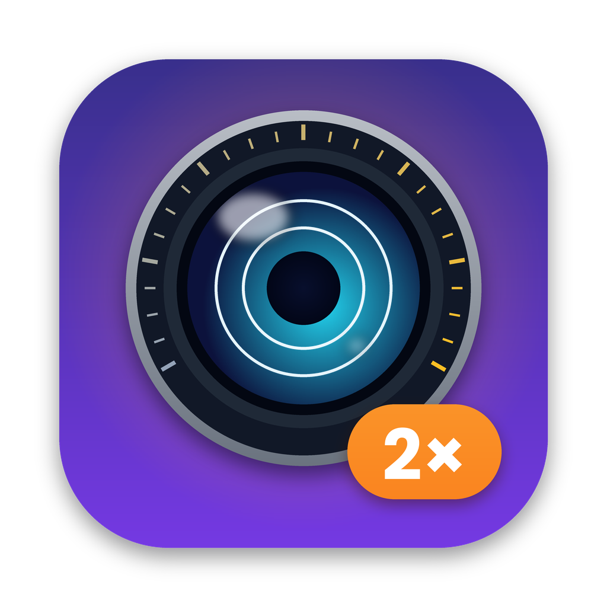

<p align="center"></p>

# ZoomCheck

How often do you really use your iPhone's telephoto lens? ZoomCheck reads your Photos library on the Mac and shows how many of your photos were taken above a given zoom level, so you can judge whether a phone with less zoom (say, one that tops out at 2x) would cost you shots you care about.

Everything runs locally. Nothing leaves your Mac.

### Thinking about the iPhone Duo?

The foldable iPhone Duo has no dedicated telephoto camera and tops out at 2x, so anything you now shoot at 3x, 4x or 5x would have to be cropped from 2x, at a fraction of the resolution. Set **Highest zoom** to **2x** and ZoomCheck shows exactly how many of your photos that affects, overall or for a single trip, and puts them in an album so you can judge whether you'd miss them.

## What it shows

- Your iPhone photos and videos split into 0.5x, 1x, 2x up to the target zoom, and above the target zoom
- Above the target, a split between **real telephoto shots** (what you'd lose) and **main-camera crops** (the other phone can do those too)
- Breakdown per iPhone model, and a switch per model to leave out photos that aren't yours (e.g. a partner's iPhone)
- Optional filters: region (rough bounding box, or a custom one) and date range, e.g. a single trip
- One click to put the "lost" photos in a Photos album, which syncs to your iPhone via iCloud


## Download

Get the latest `ZoomCheck-vX.Y.Z.dmg` from [Releases](../../releases), open it and drag ZoomCheck to Applications. It runs on Apple silicon and Intel Macs.

If a release is marked as not notarized, macOS blocks the first launch. Open ZoomCheck once, then go to System Settings → Privacy & Security and click **Open Anyway**.

## Two ways to read your library

| | Fast mode | Photos access mode |
|---|---|---|
| Permission | Full Disk Access | Regular Photos access |
| How | Reads a copy of the Photos database | Opens each original through Apple's PhotoKit |
| Whole library | Seconds | Slow; originals in iCloud get downloaded |
| A single trip | Seconds | A minute or two |

ZoomCheck starts in fast mode when it has Full Disk Access, and otherwise asks for Photos access and uses Photos access mode. In that mode, pick a date range or region first, then click **Scan**. ZoomCheck only opens the items that match and remembers what it read, so a second scan is instant. For photos it stops downloading as soon as the metadata has been read. Videos stored only in iCloud are skipped unless you turn on downloading them.

To switch to fast mode, give ZoomCheck Full Disk Access in System Settings → Privacy & Security, then quit and reopen it.

## Requirements

- macOS 14 Sonoma or later
- Xcode or the Xcode Command Line Tools (`xcode-select --install`)
- Photos library on the Mac with iCloud Photos (originals do **not** need to be downloaded)

## Build from source

```bash
git clone <repo-url> ZoomCheck
cd ZoomCheck
./scripts/build-app.sh
open build/ZoomCheck.app
```

On first launch ZoomCheck will say it has no access. Click **Open Full Disk Access settings**, turn on ZoomCheck (add it with **+** if it's not listed), quit ZoomCheck with ⌘Q and open it again.

The app is ad-hoc signed. After every rebuild macOS may treat it as a new app, and you'll need to toggle Full Disk Access off and on again.

For development, `swift run` also works when your terminal app has Full Disk Access. Creating an album only works from the `.app` bundle, because PhotoKit requires the usage description in `Info.plist`.

## How it works

The zoom level of a photo isn't stored as "2x". iPhones record two focal lengths in EXIF:

| Field | Meaning |
|---|---|
| `FocalLength` | Real focal length of the lens that took the photo |
| `FocalLengthIn35mmFilm` | 35mm equivalent, which goes up with every zoom step, including crops |

On recent Pro models, 2x is a crop of the 48 MP main sensor: same lens, same real focal length as 1x, only the 35mm value doubles (24 → 48 mm). Photos keeps both values in its own database (`ZEXTENDEDATTRIBUTES`), so ZoomCheck can read them without downloading any originals from iCloud.

- **Zoom level** = 35mm value ÷ the model's own 1x (24 mm on recent iPhones, 26–28 mm on older ones, learned from your photos), with a 15% margin
- **Crop vs. telephoto**: for each iPhone model ZoomCheck finds the real focal length of its 1x shots (the main camera). A photo above the target whose real focal length matches that is a crop; otherwise it came from a telephoto lens.
- **Videos**: Photos stores the 35mm value for videos from some iPhones only. For the others ZoomCheck uses the lens the video was shot with (e.g. "back camera 16.891mm") and the zoom level that lens has in your photos. On recent iPhones 1x and 2x share the main lens, so a 2x video counts as 1x; anything shot with the telephoto lens is still recognised.

In fast mode ZoomCheck copies `Photos.sqlite` (plus its `-wal`/`-shm` files) to a temporary folder, reads the copy and deletes it. The live library is never opened for writing. In Photos access mode it reads the same EXIF and QuickTime fields from the originals. Album creation goes through Apple's PhotoKit API in both modes.

## Limitations

- Fast mode reads Apple's private, undocumented database schema. A macOS update can change it. ZoomCheck checks the columns it needs on every load and shows which ones are missing instead of giving wrong numbers. Photos access mode doesn't depend on it.
- iPhone photos only (`Make = Apple`). Dedicated cameras with zoom lenses don't have a fixed "1x".
- Region filters are rectangles and overlap slightly with neighbouring countries. Photos without location are excluded when a region is set, and the app tells you how many.
- Fast mode isn't possible in the Mac App Store, because the sandbox doesn't allow reading the Photos database directly.

## License

MIT. See [LICENSE](LICENSE).
